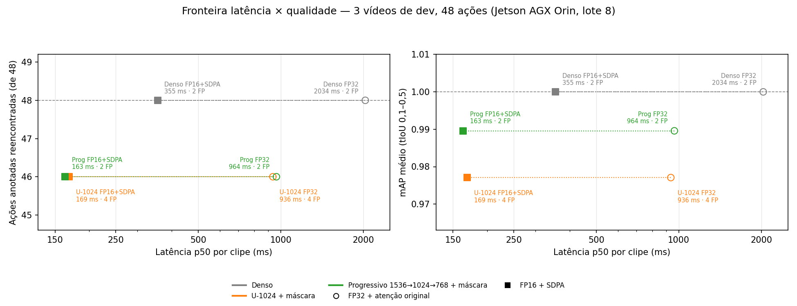
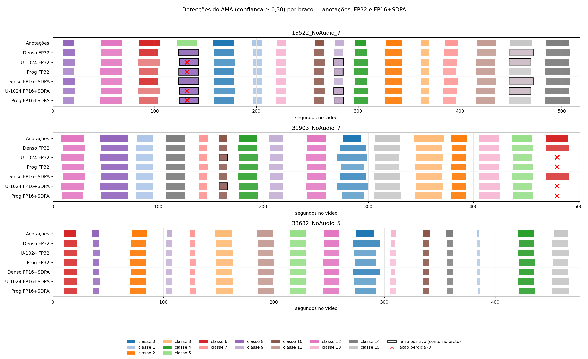
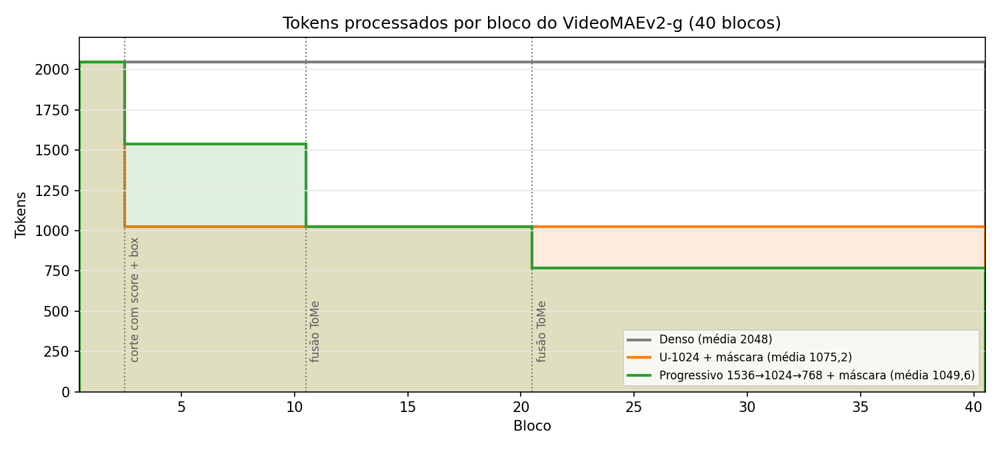
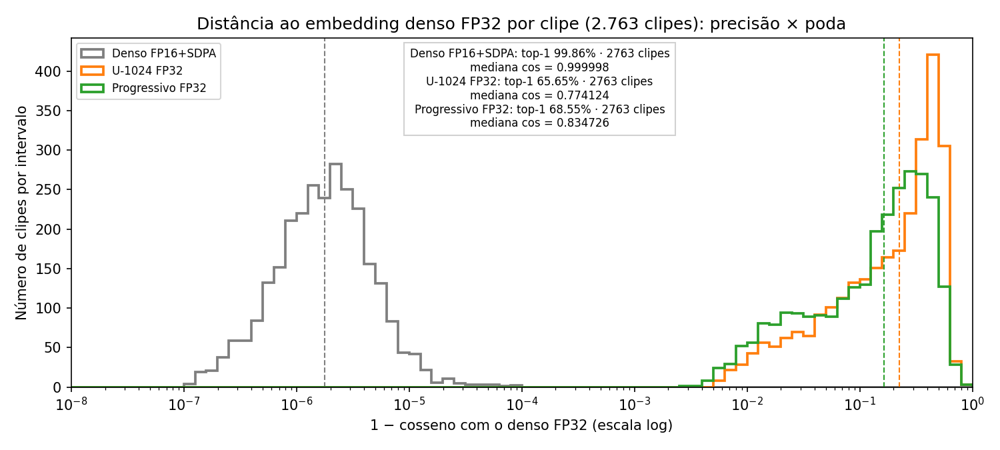
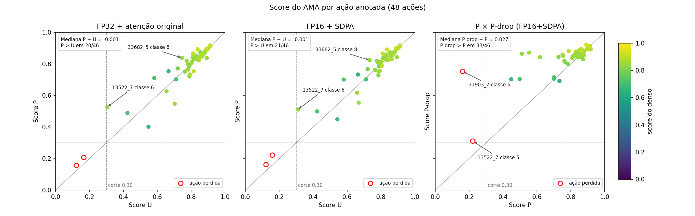

# Relatório — FP16 + SDPA e fusão progressiva

Branch `exp/fp16-sdpa-progressive` (base `12eb727`). Spec e plano locais:
`docs/superpowers/specs/2026-11-11-fp16-sdpa-progressive-design.md` e
`docs/superpowers/plans/2026-11-11-fp16-sdpa-progressive.md`. Os resultados ficam em
`benchmark/results/fp16-sdpa/`, fora do Git. Cada pasta tem o `commit.txt` do código executado.

## Condições comuns

| Item | Valor |
|---|---|
| Máquina | Jetson AGX Orin (MAXN), CUDA 12.6, torch 2.11 |
| Modelo | VideoMAEv2-g `videomae-v2_inference.pth` (`58cbaf65…`). Arquivos do VideoMAEv2 intactos |
| Vídeos (dev) | `13522_NoAudio_7`, `31903_NoAudio_7` e `33682_NoAudio_5`: 2.763 clipes, 48 ações. Pasta `motion/videos/u896-dev` |
| Amostragem | stride 16, `frame_step` 2, lote 8, corte após o bloco 2, `motion_weight` 0,5 |
| Box | `regiao-ajuste.json` (`6ad49d77…`), a mesma em todos os braços com poda. Calibrada nos motoristas de dev (`--allow-region-overlap`, registrado) |
| AMA | inalterado, labels `label_A1-train_A1-val.json`, corte 0,30 e tIoU 0,5 |
| Holdout / reserva | não usados |

**Ressalva que continua valendo:** os vídeos de dev estão no treino do AMA, e a box foi calibrada nesses
motoristas. Os números medem o quanto cada braço preserva o pipeline, não a generalização.

## 1. Opção 2 — FP16 (`autocast`) + SDPA

Opções explícitas novas:
- `PruningPlan(attention="sdpa")` e `benchmark run --attention sdpa`. Rodam cada bloco por
  `vitprune.core.attention.run_block`, que lê os pesos do próprio bloco e chama
  `F.scaled_dot_product_attention`.
- A precisão continua em `--precision fp16`.

### 1.1 Checagem curta (C2): 48 clipes, o 1º batch e o do meio de cada vídeo

Comparação contra o denso FP32 com a atenção original (`c2/check.json`):

| Configuração | Cosseno P10 / P50 / mín | max \|Δ\| prob. | Top-1 = denso FP32 | Índices mantidos = FP32 |
|---|---|---:|---:|---:|
| Denso FP32 + model | 1 / 1 / 1 | 0 | 100% | — |
| Denso FP16 + model | 0,99999 / 0,99999 / 0,99982 | 0,008 | 100% | — |
| Denso FP16 + SDPA | 0,99999 / 0,99999 / 0,99994 | 0,005 | 100% | — |
| U-1024 FP32 + model | 0,50 / 0,70 / 0,44 | 0,70 | 62,5% | 100% |
| U-1024 FP16 + model | 0,47 / 0,71 / 0,44 | 0,69 | 60,4% | 75% |
| U-1024 FP16 + SDPA | 0,47 / 0,72 / 0,45 | 0,69 | 62,5% | 75% |

- **Gate:** passou. Não houve NaN/Inf, e o denso FP16+SDPA ficou com cosseno P10 ≥ 0,999.
- **Seleção no U-1024:** em FP16, 25% dos clipes mudam algum índice mantido, por quase-empates do
  score. O efeito no embedding é da mesma ordem do da própria poda.
- **Kernel executado** (`c2/sdpa_backend.json`):
  - O `torch.profiler` não registra eventos CUDA neste Jetson: o CUPTI exige root.
  - A confirmação veio do dispatcher (`torch._fused_sdp_choice`) e de cada backend forçado, nas
    formas de um bloco (8 × 16 cabeças × N × 88):
    - **FP16 → FlashAttention.** A saída é bit a bit igual à da chamada padrão: 14,5 ms em N=2048,
      contra 28,3 ms do memory-efficient e 219 ms do math.
    - **FP32 → memory-efficient.** Flash não existe em FP32.

### 1.2 Execução completa B1 (FP16+SDPA) contra o FP32 salvo (`motion/u896-r1`)

| Braço | Recuperadas | FP | mAP médio | p50 s/clipe | p95 |
|---|---:|---:|---:|---:|---:|
| Denso FP32 (u896-r1) | 48/48 | 2 | 1,000 | 2,062 | 3,223\* |
| U-1024 FP32 (u896-r1) | 46/48 | 4 | 0,977 | 0,950 | 1,488\* |
| **Denso FP16+SDPA** | **48/48** | **2** | **1,000** | **0,326** | 0,462 |
| **U-1024 FP16+SDPA** | **46/48** | **4** | **0,977** | **0,153** | 0,218 |

\* O p95 do u896-r1 inclui um trecho com a sessão ativa (contaminação já registrada).

- **Ação por ação, denso:** o FP16+SDPA reencontra exatamente as mesmas 48 ações que o FP32, com
  max |Δscore| = 0,0003.
- **Ação por ação, U-1024:** perde as mesmas 2 ações que o FP32 (13522_7 classe 5 e 31903_7 classe 6).
  O max |Δscore| é 0,034, por causa das seleções que mudam em FP16 (§1.1).
- **Repetição em B2:** o denso FP16+SDPA tem scores idênticos, e o U-1024 fica a até 0,0004, por causa
  dos atômicos do merge.
- **Critério "preserva a qualidade"** (congelado antes): **satisfeito.** Isso liberou a B2.

## 2. Opção 3 — fusão progressiva

`PruningPlan(stages=((10, 1024), (20, 768)))` e `benchmark run --progressive 1536 10:1024 20:768`
(variante `prog_1536_1024_768_mascara`):

1. **Etapa 1, igual ao U-1024:** depois do bloco 2, o score com box mantém 1536 tokens (192 por slice),
   e o resto funde no mais parecido.
2. **Depois do bloco 10, → 1024 tokens; depois do bloco 20, → 768.** O clipe inteiro passa por
   *bipartite soft matching*, como no ToMe (arXiv 2210.09461), entre todos os slices:
   - A/B alternados;
   - as arestas de maior cosseno fundem por média ponderada pelo `size`;
   - os `size` se somam, e o pooling ponderado continua igual à média densa no instante de cada fusão.
3. **Chaves:**
   - `k = LN1(x) · W_kᵀ` do **bloco seguinte**, com `qkv.weight[D:2D]`;
   - o VideoMAE não tem viés de chave;
   - média sobre as 16 cabeças.

   É a projeção que esse bloco calcularia, calculada uma vez a mais. Cada etapa custa ≈ `2·N·D²` FLOPs,
   mais o casamento de `N/2 × N/2 × 88`. Isso roda dentro de `encode()` e entra em toda latência
   abaixo. O casamento é feito em float32, inclusive sob `autocast`.
4. **Atenção proporcional desligada**, para isolar o efeito.

**Congelamento do cronograma** (`latency-fp32-try1/latency.json`):
- FP32 com a atenção original, 48 clipes, 2 aquecimentos, 5 passes, ordem alternada;
- U-1024: p50 1.088,9 ms; P: p50 1.120,0 ms;
- razão 1,029, dentro de ±5% → aceito na 1ª tentativa.

O cronograma foi registrado no adendo da spec antes de qualquer AMA com P. Pela conta analítica, a média
é de 1.049,6 tokens por bloco, contra 1.075,2 do U-1024.

### 2.1 Execução A — FP32, atenção original

**Controle:** o código novo reproduz o FP32 salvo (`motion/u896-r1`):
- o denso fica idêntico bit a bit;
- o U-1024 fica com features a até 5,3e-5 e probabilidades a até 1,1e-5, sem nenhuma troca de status.

**Interrupção:** a execução foi pausada a pedido depois do 2º vídeo e retomada no 3º (`resume.sh`).
Ela começou no commit `f4c7578` (`a/commit-start.txt`) e terminou no `64d3453`. Entre os dois, o código
só muda em FP32 a procedência e os relatórios.

| Braço | Recuperadas | FP | mAP médio | p50 s/clipe\* |
|---|---:|---:|---:|---:|
| Denso | 48/48 | 2 | 1,000 | 2,287 |
| U-1024 | 46/48 | 4 | 0,977 | 1,056 |
| **P 1536→1024→768** | **46/48** | **2** | **0,990** | **1,084** |

\* `seconds` do `clips.jsonl`, com a ordem girando por batch. A latência de referência está no §3.

- **Perdas:** P perde as mesmas 2 ações que o U-1024: 13522_7 classe 5 e 31903_7 classe 6.
- **FPs:** P tem 2, como o denso. Some os FPs de classe 12 e de classe 9 do U-1024.
- **Nas 46 ações em comum:**

  | | Denso | U | P |
  |---|---:|---:|---:|
  | Score médio | 0,844 | 0,792 | 0,797 |
  | Erro de início | 0,60 s | 0,71 s | 0,57 s |
  | Erro de fim | 0,66 s | 0,66 s | 0,63 s |

  - Na diferença pareada de score P − U, a mediana é −0,001, e P fica maior em 20 de 46: não há
    deslocamento sistemático.
- **Ação frágil 13522_7, classe 6:** U 0,305 (a 0,005 do corte), contra P 0,526.
- **Ação 33682_5, classe 8:** U 0,745, P 0,839 e denso 0,844.
- **A e B2 concordam no status de todas as 48 ações**, para P e para U. Em P, o score varia até 0,049
  entre FP32 e FP16.

### 2.2 Execução B2 — FP16+SDPA (mesmo cronograma)

| Braço | Recuperadas | FP | mAP médio | p50 s/clipe | p95 |
|---|---:|---:|---:|---:|---:|
| Denso | 48/48 | 2 | 1,000 | 0,358 | 0,367 |
| U-1024 | 46/48 | 4 | 0,977 | 0,172 | 0,177 |
| **P 1536→1024→768** | **46/48** | **2** | **0,990** | **0,166** | **0,172** |

- **Perdas:** P perde as mesmas 2 ações que o U-1024.
- **FPs:** P fica com 2 FPs, como o denso:
  - classe 8 em 124–143 s, que o denso também tem (a confusão conhecida 5→8);
  - classe 10, que o U-1024 também tem.

  Some o FP de classe 12 e o de classe 9 do U-1024.
- **Nas 46 ações em comum** (denso / U / P):

  | | Denso | U | P |
  |---|---:|---:|---:|
  | Score médio | 0,844 | 0,791 | 0,800 |
  | Erro de início | 0,60 s | 0,71 s | 0,59 s |
  | Erro de fim | 0,66 s | 0,66 s | 0,68 s |

  - Na diferença pareada de score P − U, a mediana é 0,000, e P fica maior em 22 de 46: não há
    deslocamento sistemático.
- **Ação frágil 13522_7, classe 6:** U 0,31 (a 0,01 do corte), contra P 0,49.

## 3. Latência medida (`arms_latency.py`: 48 clipes, lote 8, 2 aquecimentos, 5 passes alternados; ms/clipe)

| Modo | Denso | U-1024 | P | P / U |
|---|---:|---:|---:|---:|
| FP32 + atenção original | 2.033,7 | 935,8 | 963,8 | 1,030 |
| FP16 + SDPA (Flash) | 355,2 | 169,1 | 163,3 | 0,966 |

- A linha FP32 vem de `latency-fp32/`, medida depois da execução A.
- A medição de congelamento (`latency-fp32-try1/`, outra sessão) deu U 1.088,9 e P 1.120,0 ms. Os
  valores absolutos mudaram entre as sessões, mas a razão ficou estável (1,029).
- O p95 fica a menos de 0,5% do p50 em todos os braços.

O custo relativo das fusões muda entre os modos. Em FP32, P fica 3% mais lento que o U-1024. Em
FP16+SDPA, fica 3% mais rápido. Isso não foi decomposto. Uma hipótese é que, com a atenção fundida, o
custo fixo por token dos blocos 3–10 pese menos frente à economia dos 768 tokens nos blocos 21–40.

## 4. Leitura

Fronteira custo × qualidade nos 3 vídeos de dev, com latência do §3 e speedup contra o denso FP32:

| Ponto de operação | ms/clipe | Speedup | Recuperadas | FP | mAP |
|---|---:|---:|---:|---:|---:|
| Denso FP32 (atual) | 2.034 | 1,0× | 48/48 | 2 | 1,000 |
| U-1024 FP32 (melhor ponto anterior) | 936 | 2,2× | 46/48 | 4 | 0,977 |
| P FP32 | 964 | 2,1× | 46/48 | 2 | 0,990 |
| **Denso FP16+SDPA** | **355** | **5,7×** | **48/48** | **2** | **1,000** |
| U-1024 FP16+SDPA | 169 | 12,0× | 46/48 | 4 | 0,977 |
| **P FP16+SDPA** | **163** | **12,5×** | **46/48** | **2** | **0,990** |

*Figura 1.* Latência p50 por clipe (`arms_latency.py`, escala log) contra as ações reencontradas e
contra o mAP. A cor indica o braço e o marcador indica o modo (círculo vazado = FP32 com a atenção
original; quadrado = FP16+SDPA). O pontilhado liga o mesmo braço nos dois modos. U-1024 e P têm as mesmas
46 ações, e por isso os pontos se sobrepõem no painel da esquerda. A diferença entre eles aparece no mAP
e nos FPs.

*Figura 2.* Detecções do AMA com confiança ≥ 0,30 nos 3 vídeos de dev.
- **Cores:** a cor indica a classe, e quanto mais opaca a barra, mais confiante a detecção.
- **Contorno preto:** falso positivo.
- **✗ vermelho:** ação anotada que o braço perdeu: 13522_7 classe 5 (o AMA a confunde com a classe 8,
  e o denso também gera esse FP) e 31903_7 classe 6.
- **Os dois modos:** FP32 (em cima) e FP16+SDPA (embaixo) dão o mesmo padrão.
- **FPs por braço:**
  - o denso tem os de classe 8 e 12;
  - o progressivo, os de classe 8 e 10;
  - o U-1024 tem esses dois e ainda o de classe 12 (13522_7, ~450 s) e o de classe 9 (31903_7,
    ~160 s).

As figuras desta seção (1–5) são geradas por `benchmark/fp16_figures.py` a partir de `fp16-sdpa/comparacao.json`,
dos `latency-fp*/latency.json` e das predições do AMA.

*Figura 3.* Tokens processados em cada um dos 40 blocos.
- **Custo:** a área sob a curva é proporcional ao custo das camadas lineares, que dominam o FLOP do
  bloco.
- **Comparação com o U-1024:** o progressivo mantém mais tokens nos blocos 3–10 e menos nos blocos
  21–40. A média ao longo dos blocos é de 1.049,6 tokens, contra 1.075,2 do U-1024.

*Figura 4.* Distância (1 − cosseno) entre o embedding de cada clipe e o do denso FP32, nos 2.763 clipes,
em escala log.

| | Mediana do cosseno | Top-1 da cabeça igual ao denso FP32 |
|---|---:|---:|
| Denso FP16+SDPA | 0,999998 | 99,86% (4 clipes diferem) |
| U-1024 FP32 | 0,774 | 65,7% |
| Progressivo FP32 | 0,835 | 68,6% |

- **Precisão contra poda:** o erro do FP16+SDPA fica cinco ordens de grandeza abaixo do erro da poda.
- **Progressivo contra U-1024:** o progressivo fica mais perto do denso. O P10 do cosseno é 0,554,
  contra 0,481 do U-1024.

*Figura 5.* Score do AMA de cada ação anotada no U-1024 (x) e no progressivo (y), com a cor dada pelo
score do denso.
- **Ações perdidas:** os círculos vermelhos são as 2 ações que os dois braços perdem. Elas aparecem com
  a melhor detecção da classe certa, abaixo do corte de 0,30.
- **Deslocamento:** não há deslocamento sistemático. A mediana de P − U é −0,001 em FP32 e 0,000 em
  FP16. P fica acima em 20 de 46 em FP32 e em 22 de 46 em FP16.
- **Ações destacadas:** a ação frágil 13522_7, classe 6, sobe de ~0,31 para ~0,5. A 33682_5, classe 8,
  sobe de ~0,74 para ~0,84, perto do denso (0,84).

1. **FP16 + SDPA é a melhoria dominante.**
   - **O denso** fica 5,7× mais rápido sem nenhuma mudança na tarefa: as mesmas 48 ações, os mesmos 2 FPs
     e scores a até 0,0003.
   - **Contra o melhor ponto anterior:** o denso FP16+SDPA é 2,6× mais rápido que o U-1024 FP32 e não
     perde as 2 ações que ele perde.
   - **Com a poda por cima,** o ganho cai pela metade de novo (~2,1×), com a mesma perda de 2 ações que
     a poda já tinha em FP32.
2. **A fusão progressiva melhora pouco, mas de forma consistente nos dois modos, sem mudar o custo**
   (+3% em FP32, −3,5% em FP16).
   - **O que melhora:** cai o FP extra do U-1024 (4 → 2, como o denso), o mAP sobe (0,977 → 0,990), o
     erro de início volta ao nível do denso, e a única ação recuperada por um fio (0,305) sobe para
     ~0,5.
   - **O que não muda:** as 2 ações sutis perdidas a ~1.024 tokens. O score pareado não tem
     deslocamento sistemático.
   - **Peso da evidência:** com 48 ações e o mAP saturado, a diferença é de 2 detecções e não é
     significância estatística.
3. **Recomendação:**
   - **Ponto padrão:** FP16+SDPA, que custa zero na tarefa.
   - **Para ~2× a mais:** P no lugar do U-1024, que é mais limpo em FPs pelo mesmo custo.
4. **Próximos passos,** que dependem do responsável:
   - **Holdout:** confirmar o denso FP16+SDPA e P/U em FP16 nos motoristas 35418 e 36305, com uma box
     sem sobreposição.
   - **Cronograma mais agressivo em FP16:** por exemplo, terminar em 512. O ganho absoluto restante é
     pequeno (~165 → ~145 ms por clipe, pela conta de tokens por bloco), contra o risco de perder mais ações.
   - **`torch.compile`/TensorRT:** não foram explorados.

**Limites:**
- os vídeos de dev estão no treino do AMA;
- a box foi calibrada nesses motoristas;
- n = 48 ações em 3 vídeos;
- BF16, TF32 e outros cronogramas ficaram fora.

## 5. Candidatos registrados

**Status:** candidatos no conjunto de dev. Ainda falta confirmar no holdout (35418, 36305), com uma box
sem sobreposição.

| Prioridade | Candidato | Configuração | Medido no dev |
|---|---|---|---|
| **Preservar a qualidade** | Denso FP16 + SDPA | `--precision fp16 --attention sdpa`, sem poda (`PruningPlan.dense(attention="sdpa")` sob `autocast` fp16) | 355 ms/clipe (5,7×); 48/48 ações, 2 FP, mAP 1,000; idêntico ao denso FP32 na tarefa |
| **Latência** (atual, desde 12/11) | **P-drop FP16 + SDPA** — fundo descartado no corte | `--precision fp16 --attention sdpa --progressive-discard 1352 10:1024 20:768` com a box (`PruningPlan(prune_layer=2, budget=FixedBudget(1352), spatial_prior=box, discard_outside=True, stages=((10, 1024), (20, 768)), attention="sdpa")`) | 151,6 ms/clipe (≈13,4×; 2,28× sobre o denso FP16+SDPA); 48/48 ações, 2 FP (os mesmos do denso), mAP 1,000. Ver a §7 |
| Latência (anterior, substituído) | Progressivo FP16 + SDPA | `--precision fp16 --attention sdpa --progressive 1536 10:1024 20:768` com a box (`PruningPlan(prune_layer=2, budget=FixedBudget(1536), spatial_prior=box, stages=((10, 1024), (20, 768)), attention="sdpa")`) | 163 ms/clipe (12,5×); 46/48 ações, 2 FP, mAP 0,990; perde 13522_7 classe 5 e 31903_7 classe 6 |

**Status do P-drop:**
- é candidato **pendente de confirmação** no holdout (35418, 36305), com uma box calibrada sem esses
  motoristas;
- depende inteiramente da box, mais que qualquer outro braço (§7);
- substituiu o progressivo como candidato de latência em 12/11, por decisão do responsável, depois do
  veredito "melhora" pela regra pré-registrada.

O denso FP16+SDPA continua sendo a referência de qualidade para o candidato de latência. O U-1024 fica
como linha de base de comparação, não como candidato: com o mesmo custo, ele tem 2 FPs a mais que o
progressivo.

## 6. Fusão separada pela box (P-sep) — experimento exploratório (2026-11-12)

Pré-registro: `docs/superpowers/specs/2026-11-12-region-separated-merge.md` (local, com a emenda do
controle). Resultados: `benchmark/results/fp16-sdpa/sep/`.

**Regra.** É o mesmo progressivo, mas nenhuma fusão cruza a fronteira da box:
- **No corte do bloco 2,** um token de fora vai para o mantido mais parecido de fora, na mesma fatia, e
  um de dentro, para o mantido mais parecido de dentro.
- **Nas fusões ToMe,** as arestas entre dentro e fora recebem cosseno − 3.
- **Fallback:** se não houver par do mesmo grupo, vale o mais parecido entre todos. Isso não ocorreu
  em nenhuma etapa.
- **Opções:** `PruningPlan.separate_region` e `--progressive-separate` (variante `prog_…_mascara_sep`).
- **Caminho padrão:** com a opção desligada, ele é bit a bit idêntico ao código anterior (CPU,
  `sep/check/regress.py`).

**Diagnóstico** (48 clipes da C2, `sep/check/check.json`): fusões que cruzam a fronteira em cada
etapa.

| Etapa | P | P-sep |
|---|---:|---:|
| Corte (bloco 2) | 96,8% | 0% |
| ToMe (bloco 10) | 4,6% | 0% |
| ToMe (bloco 20) | 6,9% | 0% |

No P, quase todo token de fundo descartado no corte vai parar dentro de um token do motorista, embora
existam 23 mantidos de fora por fatia.

**Execução** (FP16+SDPA, 3 vídeos de dev, a mesma sessão com ordem alternada; `sep/comparacao.md`):

| Braço | Ações | FP | mAP | Latência p50 relativa a P (`arms_latency`) |
|---|---:|---:|---:|---:|
| Denso | 48/48 | 2 (classes 8 e 12) | 1,000 | 2,18× |
| P | 46/48 | 2 (classes 8 e 10) | 0,990 | 1,000 |
| **P-sep** | **48/48** | **4** (classes 8, 10, 12 e 1) | **0,990** | **1,008** |

- **Ações:** P-sep recupera as 2 ações que todos os braços com poda perdiam: 13522_7 classe 5 (score
  0,336) e 31903_7 classe 6 (0,326). As duas ficam acima da margem de fragilidade (±0,02 de 0,30), mas
  perto do corte.
- **FPs novos:** classe 12 em 13522_7 (0,31), que o denso também tem (0,33), e classe 1 em 33682_5 (0,38).
- **Nas 46 ações em comum,** o score médio é 0,812 em P-sep, 0,798 em P e 0,844 no denso. Na diferença
  pareada P-sep − P, a mediana é +0,002, e P-sep fica maior em 27 de 46.
- **Latência:** P-sep custa +0,8% sobre P, dentro dos ±2% pré-registrados.
- **Valores absolutos desta sessão:** denso 486, U-1024 231, P 223 e P-sep 225 ms por clipe. Eles ficaram
  ~37% acima dos de 11/11, porque havia uma sessão gráfica ativa (navegador) dividindo o GPU. As razões,
  medidas na mesma sessão, batem com as de 11/11 (denso/U 2,10; P/U 0,964). Por isso a tabela usa razões.
- **Réplica do P:** o P desta execução repete o P da B2 em 48 de 48 status e em FP, com |Δscore| de
  mediana 0,002 e máximo 0,042.
- **Reprodutibilidade, corrigida em 12/11:**
  - Com o código da B2 (`f4c7578`, `size` em FP16), o P não era bit a bit reprodutível entre processos.
  - Com o código atual (`size` em float32, desde `24c844f`), duas execuções independentes (`sep` e
    `drop`, §7) deram o P, o P-sep e o denso bit a bit idênticos.
  - A diferença contra a B2 vem, portanto, da mudança de código, e não de uma instabilidade do
    progressivo.

**Veredito pela regra pré-registrada: piora**, porque P-sep acrescenta FP (2 → 4). A regra punia
qualquer FP novo, mesmo com ganho de ações.

**Leitura:**
- **O que a regra não capta:** a separação troca precisão por recall. É o primeiro braço com poda que
  reencontra as 48 ações, o mesmo recall do denso, com mAP igual ao de P e o custo de P. Os FPs a mais
  são um que o próprio denso também comete e um novo, de classe 1.
- **Peso da evidência:** a diferença é de 2 ações e 2 FPs, com scores perto do corte. Isso fica dentro
  do que poucas detecções podem inverter.
- **Para adotar P-sep como candidato** quando a prioridade for o recall, falta uma confirmação
  pré-registrada fora deste conjunto, com uma regra que pondere ações e FPs explicitamente.
- **Até lá,** os candidatos da §5 continuam os mesmos.

## 7. Descartar o fundo no corte (P-drop) — hipótese 2 (2026-11-12)

Branch `exp/discard-background`. Pré-registro: `docs/superpowers/specs/2026-11-12-discard-background.md`
(local). Resultados: `benchmark/results/fp16-sdpa/drop/`.

**Hipótese.** O AMA foi treinado com embeddings de vídeos **recortados no motorista**. Descartar os
tokens de fora da box, em vez de fundi-los, aproximaria o embedding do que o AMA viu no treino.

**Regra.**
- **No corte do bloco 2,** os 87 tokens de fora da box de cada fatia são descartados: não ficam e não
  se fundem.
- **Os 169 tokens de dentro ficam todos** (1.352 por clipe), sem fusão no corte.
- **Depois,** as fusões ToMe do progressivo continuam (bloco 10 → 1024, bloco 20 → 768), e o pooling
  ponderado é feito sobre o que restou. O embedding vira a média da região do motorista.
- **Opções:** `PruningPlan.discard_outside` e `--progressive-discard 1352 10:1024 20:768` (variante
  `prog_1352_1024_768_mascara_drop`).
- **Caminho padrão:** com a opção desligada, ele é bit a bit idêntico ao código anterior (CPU,
  `drop/check/regress2.py`).
- **Checagem na GPU:** o bloco 3 recebe `[8, 1352, 1408]`, e a saída é finita.

**Execução** (FP16+SDPA, 3 vídeos de dev, a mesma sessão com ordem alternada; latência de
`arms_latency`, 48 clipes):

| Braço | Ações | FP | mAP | Score médio (46 em comum) | ms/clipe | vs P |
|---|---:|---:|---:|---:|---:|---:|
| Denso | 48/48 | 2 (classes 8 e 12) | 1,000 | 0,844 | 345,9 | 2,19× |
| U-1024 | — | — | — | — | 160,9 | 1,02× |
| P | 46/48 | 2 (classes 8 e 10) | 0,990 | 0,798 | 158,1 | 1,00× |
| P-sep | 48/48 | 4 (classes 8, 10, 12 e 1) | 0,990 | 0,812 | 158,5 | 1,00× |
| **P-drop** | **48/48** | **2 (classes 8 e 12)** | **1,000** | **0,847** | **151,6** | **0,96×** |

O U-1024 não entrou nesta execução. A linha dele só traz a latência, medida na mesma sessão.

**P-drop contra P:**
- **Ações:** recupera as 2 ações que P perde.
  - 31903_7 classe 6 sai com score 0,753, como no denso (0,748).
  - 13522_7 classe 5 sai com 0,31, perto do corte. O denso dá 0,40.
- **FPs:** os mesmos 2 FPs do denso, de classe 8 e de classe 12, este último com 0,31 (o denso dá 0,33).
  Some o FP de classe 10 do P.
- **Score pareado nas 46 ações em comum:** P-drop − P tem mediana +0,027, e P-drop fica maior em 33 de
  46.
- **Latência:** é 4% mais rápido que P, 5,8% mais rápido que o U-1024 e 2,28× mais rápido que o denso
  FP16+SDPA. Contra o denso FP32, isso dá ≈13,4×.

**Veredito pela regra pré-registrada: melhora.**
- **Cálculo completo:** N = Δações − ΔFP = +2 − 0 = **+2**, com mAP 1,000 contra 0,990.
- **Sem os itens frágeis** (a ação 13522_7 classe 5 e o FP de classe 12, os dois com score 0,31): N =
  +1 − (−1) = **+2**.
- Os dois cálculos concordam, então o resultado não é "inconclusivo".

**Réplicas e reprodutibilidade.** O P e o P-sep desta execução são bit a bit idênticos aos da execução
`sep`, nas features e nos scores, em processos independentes.

**Leitura:**
- **O P-drop iguala o denso na tarefa nos 3 vídeos de dev:** as mesmas 48 ações, os mesmos FPs, mAP 1,000
  e score médio equivalente (0,847 contra 0,844). Ele é mais rápido que todas as variantes anteriores.
- **Interpretação:** o resultado é coerente com a hipótese. Fundir o fundo nos tokens do motorista
  atrapalhava, e separar (P-sep) já recuperava as ações. Descartar o fundo tira a contaminação e ainda
  aproxima o embedding do recorte com que o AMA foi treinado.
- **Ressalva mais forte que nos outros braços:** o P-drop depende inteiramente da box, e esta box foi
  calibrada nos mesmos motoristas avaliados. Num motorista novo, uma box mal posicionada cortaria
  partes do próprio motorista, e o P-drop não tem como recuperá-las. A confirmação no holdout
  (35418, 36305), com uma box sem sobreposição, é condição para adotá-lo.
- **Candidatos:** o P-drop é o candidato natural para a prioridade de latência, no lugar do P. A troca
  na §5 fica para a decisão do responsável e para a confirmação fora do conjunto de dev.

### 7.1 Poda ou fusão? Como classificar o P-drop

Entre todos os braços testados, o P-drop é o único que **descarta tokens de verdade**. Todos os outros
(U-1024, P, P-sep e as políticas da QABP) reduzem tokens só por **fusão**: o que sai é incorporado,
por média ponderada, num token que fica.

**De onde vem a economia** (tokens × blocos, sobre os 81.920 do denso; as camadas lineares dominam o custo,
§3):

| Braço | Economia | Por descarte (poda) | Por fusão |
|---|---:|---:|---:|
| U-1024 | 38.912 (47,5%) | 0% | 100% |
| P | 39.936 (48,8%) | 0% | 100% |
| **P-drop** | **41.408 (50,5%)** | **63,9%** (696 tokens × 38 blocos) | **36,1%** (ToMe nos blocos 10 e 20) |

**Classificação.** O P-drop é um método **híbrido**:
- **Poda espacial** guiada por região: os tokens de fora da box são descartados depois do bloco 2. Essa
  parte responde por ~64% da economia.
- **Fusão por similaridade** (ToMe) nos blocos 10 e 20, responsável pelos outros ~36%.

Na taxonomia da literatura, isso o põe entre os métodos que combinam poda e fusão (ToFu, PPT,
DiffRate), com a particularidade de que a poda é decidida por uma região, e não por um escore de
importância. Dentre os braços testados, é o que melhor corresponde ao nome *ViT-Prune*: é o único em que a
poda, no sentido estrito de descartar tokens, acontece de fato, e é ela que carrega a maior parte da
economia.

Dois cuidados para descrever o método com precisão:
1. **No P-drop, o escore de unicidade × movimento não decide nada.** Com 1.352 tokens, todas as 169
   posições da box ficam, e o que é podado é decidido só pela box. O escore só voltaria a pesar com um
   orçamento abaixo de 169 por fatia.
2. **A box é parte do método.** Ela vem de um detector de pessoas (YOLO26s), calibrado por mediana nos
   vídeos de ajuste. A qualidade da poda depende de ela cobrir o motorista em motoristas novos, e é isso
   que o holdout precisa confirmar.

**A trajetória das ablações, como uma escada** (cada degrau muda um fator; FP16+SDPA, 3 vídeos de dev):

| Degrau | Mudança | Ações | FP | mAP | ms/clipe |
|---|---|---:|---:|---:|---:|
| Denso FP32 | linha de base | 48 | 2 | 1,000 | 2.034 |
| Denso FP16+SDPA | precisão e kernel | 48 | 2 | 1,000 | 346–355 |
| U-1024 | corte único no bloco 2 (escore + box) e fusão no mais parecido | 46 | 4 | 0,977 | 161–169 |
| P | redução em etapas (1536 → 1024 → 768), fusão ToMe | 46 | 2 | 0,990 | 158–163 |
| P-sep | fusão proibida entre fundo e motorista | 48 | 4 | 0,990 | 158 |
| **P-drop** | **fundo descartado no corte** | **48** | **2** | **1,000** | **152** |

As latências em faixa vêm de sessões diferentes (§3, §6, §7). As razões entre braços medidas na mesma
sessão são estáveis.
